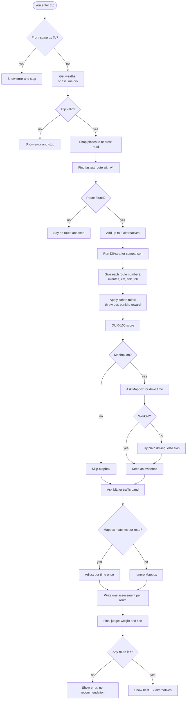
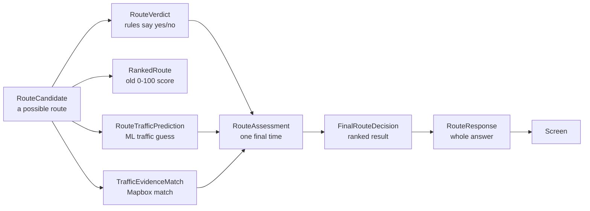

# Architecture

This file shows how the pieces of the app fit together and the order a request travels through them.

Plain-language version: see [workflow.md](workflow.md).

## 1. The big picture

```
        YOU
         |
         v
   +-------------+        "take me from A to B"
   |   app.py    | ----------------------------+
   | (the screen)|                             |
   +-------------+                             v
         ^                            +------------------+
         |      the final answer      |  RouteService    |
         +--------------------------- |  (the manager)   |
                                      +------------------+
                                               |
          +-------------+-------------+--------+--------+-------------+
          |             |             |                 |             |
          v             v             v                 v             v
     +---------+   +---------+   +---------+      +---------+   +---------+
     |  Roads  |   |  Rules  |   |   ML    |      | Mapbox  |   | Weather |
     | routing |   | if/then |   | traffic |      |  time   |   |         |
     +---------+   +---------+   +---------+      +---------+   +---------+
```

Read it as: **the screen asks the manager, the manager asks all the helpers, then sends one answer back to the screen.**

## 2. The pieces

| File | Plain job |
| --- | --- |
| `app.py` | The screen. Form, buttons, map. Does no thinking. |
| `src/service.py` (`RouteService`) | The manager. Calls everyone else in the right order. |
| `src/osm_graph.py` | Loads the real road network from OpenStreetMap. |
| `src/pathfinding/` | Finds routes: A*, Dijkstra, and alternatives. |
| `src/eta.py` | Turns road length and speed into minutes; flags risk, tolls, unlit roads. |
| `src/expert_system.py` | Hand-written if/then rules (veto, penalise, reward). |
| `src/decision.py` | The original class-project 0-100 score. |
| `src/mapbox_client.py` | Optionally asks Mapbox for drive time. |
| `src/traffic_evidence.py` | Checks whether Mapbox's answer matches our road, then adjusts once. |
| `src/route_traffic_ml.py` | Guesses LOW / MEDIUM / HIGH traffic from a trained model. |
| `src/ai/optimizer.py` | The final judge. Picks the winner. |
| `src/contracts.py` | The labelled data boxes passed between modules. |

## 3. What happens, step by step

```
1. You enter the trip
        |
        v
2. Check the trip is valid
        |
        v
3. Find the nearest real roads
        |
        v
4. Find a route + a few alternatives
        |
        v
5. Give each route numbers
   (minutes, km, risk, toll)
        |
        v
6. Apply the if/then rules
   (throw out / punish / reward)
        |
        v
7. Optional: ask Mapbox for real drive time
        |
        v
8. Ask ML: light, medium, or heavy traffic?
        |
        v
9. Combine everything into ONE final time per route
        |
        v
10. Pick the best + 2 alternatives
        |
        v
11. Show it on the screen
```

## 4. Full request flow



## 5. How the data boxes chain



## 6. Where the files live

```text
app.py                      the screen
src/service.py              the manager
src/osm_graph.py            road network
src/pathfinding/            A*, Dijkstra, alternatives
src/eta.py                  time, risk, toll
src/expert_system.py        if/then rules
src/decision.py             old score
src/mapbox_client.py        Mapbox client
src/traffic_evidence.py     Mapbox-to-road matching
src/route_traffic_ml.py     ML traffic band
src/ai/optimizer.py         final judge
src/contracts.py            data boxes
data/cache/                 saved road map
models/                     saved ML models
reports/                    evaluations
```
