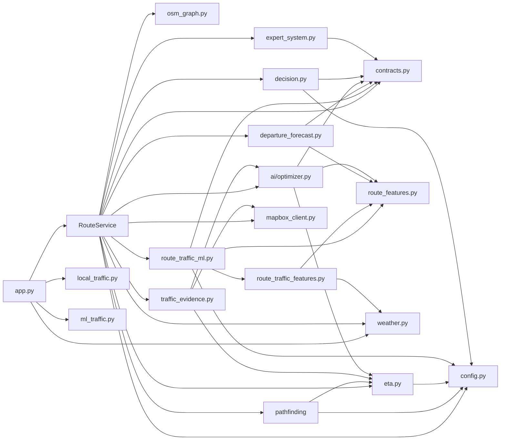
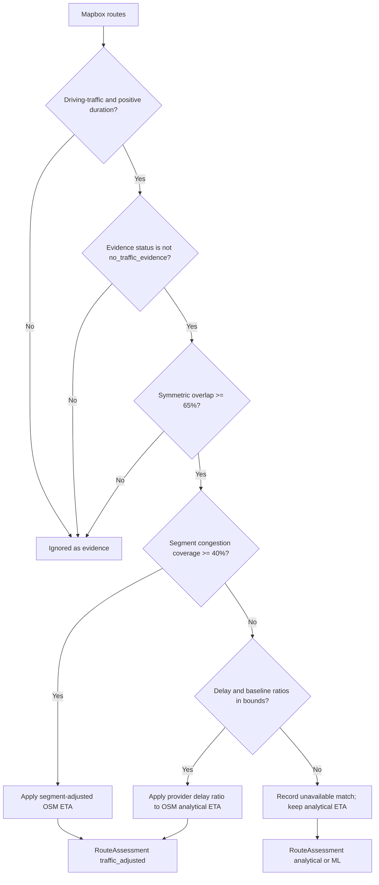
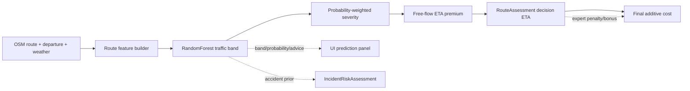

# Component Interactions

## 1. Interaction overview

The application uses a hub-and-spoke interaction model. `app.py` is the presentation hub, and `RouteService` is the orchestration hub. Domain modules do not import Streamlit, and most domain logic receives plain dataclasses or NetworkX graphs.



`src/routing.py` and `src/final_optimizer.py` are compatibility facades. They re-export implementation symbols and are not independent business-logic layers.

## 2. Primary sequence with explicit contracts

```mermaid
sequenceDiagram
    autonumber
    participant App as app.py
    participant RS as RouteService
    participant Cfg as config
    participant OSM as osm_graph
    participant Alt as alternatives/A*
    participant Eta as eta
    participant Exp as expert_system
    participant Dec as decision
    participant Mb as mapbox_client
    participant Pred as route_traffic_ml
    participant Ev as traffic_evidence
    participant Opt as ai/optimizer

    App->>RS: route(origin, destination, departure, preference, weather, avoid_tolls, include_mapbox)
    RS->>Cfg: LANDMARKS, BBOX, PREFERENCE_WEIGHTS
    RS->>OSM: nearest_node_with_distance()
    RS->>Alt: generate_candidates(routing_graph, start, goal)
    Alt-->>RS: list[PathResult]
    RS->>Alt: dijkstra(routing_graph, start, goal)
    Alt-->>RS: PathResult or None
    loop each OSM path
        RS->>Eta: route_eta_min(), route_risk(), route_toll(), route_unlit_ratio()
        Eta-->>RS: analytical values
        RS->>RS: create RouteCandidate
    end
    RS->>Exp: evaluate_route(candidate, minima, context)
    Exp-->>RS: RouteVerdict(trace, veto, penalty, bonus)
    RS->>Dec: rank_routes(candidates, verdicts, preference)
    Dec-->>RS: list[RankedRoute]
    opt include_mapbox and token present
        RS->>Mb: fetch_routes(profile=mapbox/driving-traffic, depart_at)
        Mb-->>RS: tuple[MapboxRoute]
        opt traffic profile failed
            RS->>Mb: fetch_routes(profile=mapbox/driving)
            Mb-->>RS: tuple[MapboxRoute] or MapboxError
        end
    end
    loop each non-vetoed OSM route
        RS->>Pred: predict(route, departure, graph, weather)
        Pred-->>RS: RouteTrafficPrediction or unavailable
        RS->>Ev: match_traffic_evidence(route, mapbox_routes)
        Ev-->>RS: TrafficEvidenceMatch or None
        RS->>Ev: build_route_assessment(...)
        Ev->>Opt: build_incident_risk()
        Opt-->>Ev: IncidentRiskAssessment
        Ev-->>RS: RouteAssessment
    end
    RS->>Opt: build_final_recommendation(assessments=...)
    Opt-->>RS: FinalRecommendation
    RS-->>App: RouteResponse
    App->>App: render cards, details, map, technical panel
```

## 3. Data-contract ownership

All major dataclasses are frozen and live in `src/contracts.py`.

| Contract | Produced by | Consumed by | Purpose |
| --- | --- | --- | --- |
| `RouteCandidate` | `RouteService._candidate`, `_mapbox_candidate` | expert system, academic ranking, evidence matching, optimizer | Unified route representation |
| `RuleTrace` | `expert_system` | UI technical details | Explain one fired rule |
| `RouteVerdict` | `evaluate_route` | `decision`, `optimizer`, `build_route_assessment` | Veto/penalty/bonus decision |
| `RankedRoute` | `decision.rank_routes` | optimizer, UI | Academic comparison rank |
| `BaselineComparison` | `RouteService.route` | UI technical details | A* vs Dijkstra comparison |
| `MapboxRoute` | `mapbox_client._parse_route` | service, evidence matcher, forecast | Provider route evidence |
| `RouteTrafficPrediction` | `route_traffic_ml` | assessment, optimizer, UI | ML band, probabilities, advice, provenance |
| `TrafficEvidenceMatch` | `traffic_evidence.match_traffic_evidence` | `build_route_assessment` | One provider/OSM match decision |
| `RouteAssessment` | `traffic_evidence.build_route_assessment` | final optimizer, UI | One decision ETA and all evidence |
| `FinalRouteDecision` | `ai/optimizer` | UI selection and rendering | Ranked assessed route |
| `FinalRecommendation` | `ai/optimizer` | `RouteResponse`, UI | Recommended route and alternatives |
| `WeatherSnapshot` | `weather.fetch_weather` or fallback | ETA, expert system, ML features, UI | Weather condition and source |
| `RouteResponse` | `RouteService.route` | `app.py` session state | Complete result for one request |

## 4. Module dependency rules

### Allowed dependency direction

```text
app.py
  -> service / weather / local_traffic / ml_traffic
service.py
  -> config, contracts, pathfinding, eta, decision, expert_system,
     mapbox_client, osm_graph, route_traffic_ml, traffic_evidence,
     traffic_prediction, departure_forecast, ai/optimizer
traffic_evidence.py
  -> contracts, eta, mapbox_client, ai/optimizer (incident risk only)
route_traffic_ml.py
  -> contracts, calendar_features, route_traffic_features, route_features, config
ai/optimizer.py
  -> contracts, config, eta, route_features
```

### Deliberate boundaries

- Pathfinding does not know about traffic evidence or ML.
- The expert system does not call the model; it evaluates facts already placed in working memory.
- The ML predictor does not rank routes; it only predicts a traffic band and related advice.
- The evidence matcher does not choose the final route; it produces one assessment.
- The optimizer does not call external APIs; it consumes assessments.
- The UI does not construct routes or access model internals.

### Compatibility facades

- `src/routing.py` re-exports `PathResult`, `astar`, `dijkstra`, `generate_candidates`, `graph_vmax_kph`, and related helpers.
- `src/final_optimizer.py` re-exports optimizer symbols and aliases `_overlap_ratio = _edge_overlap`.

These facades preserve older imports but should not be documented as separate algorithms.

## 5. Academic ranking vs final ranking

Two rankings coexist:

| Layer | Function | Inputs | Role | Display |
| --- | --- | --- | --- | --- |
| Academic | `src/decision.py::rank_routes` | analytical candidates + verdicts | Preference-weighted baseline; used as comparison and fallback | `academic_rank`, academic score |
| Final AI | `src/ai/optimizer.py::build_final_recommendation` | assessments + verdicts + academic rankings | Recommended route and top alternatives | recommendation cards, final cost, advice |

The final layer does not add the academic cost again. It normalizes the assessment decision ETA, distance, and road risk, then applies the expert multiplier and optional ML-confidence penalty.

## 6. How Mapbox interacts with the rest of the system



In the live path, Mapbox routes are not passed into the assessed recommendation as competing route choices. The optimizer is informed only that Mapbox was considered; it warns that provider routes were used as evidence for OSM candidates.

## 7. How ML interacts with the expert system and optimizer



The expert system is **not** given the ML band. It evaluates the OSM route's analytical ETA, risk, toll, unlit ratio, congestion if present, and context. The final optimizer applies the expert multiplier after the ML-based decision time is chosen.

## 8. Failure propagation

| Failing component | Propagated signal | Consumer response |
| --- | --- | --- |
| OSM graph load | `GraphLoadError` | App shows request failure |
| A* no path | empty candidate list | `RouteResponse` without routes |
| Dijkstra no path | `baseline=None` | UI omits baseline comparison |
| Expert rule exception | not caught inside `evaluate_route` | request fails; no silent veto bypass |
| Mapbox traffic failure | `MapboxError` | ordinary driving fallback |
| Mapbox both fail | warning + `no_mapbox` | OSM-only continuation |
| ML load failure | prediction unavailable | analytical decision ETA |
| ML invalid departure | `status="invalid_request"` | no ML adjustment, warning |
| Accident model failure | `partial` status or unknown | external prior marked unavailable |
| Evidence match failure | non-applied match or `None` | analytical/ML ETA retained |
| No usable assessment | `_fallback_assessment` | analytical ETA; warning |
| All routes vetoed | empty recommendation | app error, no recommendation |
| UI weather failure | dry fallback | route continues |

## 9. State and side effects

- `RouteService.__init__` loads the graph and model services; this is process-level cached state.
- `RouteService.route` is otherwise request-scoped except for model caches inside the injected services.
- The app stores only the latest `RouteResponse` and selection keys in Streamlit session state.
- The Mapbox client has no cache; provider results are transient.
- Local traffic append/validate functions can write a CSV, but the Streamlit workflow only reads and summarizes it.
- Training scripts write models, simulated data, metadata, and reports; they are separate offline processes.
- No component sends telemetry or records user trips.

## 10. Interaction invariants

1. Every OSM candidate must have an expert verdict before final eligibility.
2. A vetoed route cannot be recommended.
3. The final recommendation displays at most three routes and exactly one recommended route.
4. Duplicate fingerprints and >70% edge/geometry overlap are removed.
5. A provider ETA is never assigned as the ML prediction, and an ML band is never presented as live provider evidence.
6. A decision assessment has exactly one ETA basis.
7. Missing incident evidence is `UNAVAILABLE`, not zero.
8. Mapbox evidence is excluded when the departure changes after evidence was fetched.
9. Synthetic ML labels remain disclosed in every consumer.
