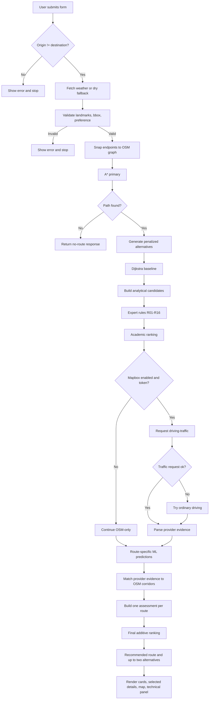

# End-to-End Workflow

## 1. Summary

A normal request starts in the Streamlit form, passes through validation, OSM graph snapping and routing, analytical assessment, deterministic expert rules, optional provider evidence, route-specific ML inference, and one final additive ranking layer. The result is a saved `RouteResponse` containing a `FinalRecommendation`, which drives the route cards, the selected-route panel, the map, and technical details.

The complete live path is implemented by `RouteService.route()` in `src/service.py`, with final assessment orchestration in `RouteService.recommend_routes()`.

## 2. Numbered workflow

### Step 1 - The user opens the app

`app.py` sets the page title and caption, creates caches for the service and weather, and displays a form. The form defaults are:

- From: first landmark in `LANDMARKS` (`Johar Chowk Mosque`).
- To: fourth landmark (`Block 8 bus stop`).
- Departure date: tomorrow.
- Departure time: `09:00`.
- Preference: `Fastest`.
- Strict toll avoidance: off.
- Use matched Mapbox traffic evidence: on.

### Step 2 - Streamlit validates the basic form

`main()` rejects identical origin and destination names before calling the service. The date and time are combined into a naive local `datetime`. No timezone is attached at the UI boundary.

### Step 3 - Weather is fetched, or safely replaced

`get_weather(lat, lon)` calls `src/weather.py::fetch_weather()` for the origin coordinate. The function requests current temperature, precipitation, rain, and weather code from Open-Meteo with a 10-second timeout.

If the request, JSON parse, or field conversion fails, it returns:

- `condition="dry"`,
- `source="fallback"`,
- a warning string.

The workflow continues; weather failure does not block routing.

### Step 4 - `RouteService.route()` validates domain input

The service checks:

- origin exists in `LANDMARKS`,
- destination exists in `LANDMARKS`,
- origin and destination differ,
- preference is one of `Fastest`, `Shortest`, `Least congested`, `Safest`,
- both coordinates are inside the approved bbox.

Invalid input raises `ValueError`, and the app displays a route-request error.

### Step 5 - Landmarks are snapped to the road graph

`nearest_node_with_distance()` scans graph nodes with the haversine distance and returns the nearest node plus the snap distance. A warning is added when either endpoint is more than `SNAP_WARNING_DISTANCE_M = 75 m` from a drive road. This means the route starts/ends at a snapped access point, not necessarily at the landmark's exact coordinate.

### Step 6 - The primary route and alternatives are generated

`generate_candidates()` in `src/pathfinding/alternatives.py`:

1. Runs A* with the normal OSM base-time weights.
2. Penalizes all edges used by the primary route with factor `1.8` and reruns A*.
3. Penalizes all accepted edges with factor `3.0`, then `5.0`.
4. Accepts at most three alternatives.
5. Rejects exact duplicates, routes more than 45% slower than the primary, and routes with more than 70% edge overlap with an accepted route.

If no path exists, the service returns an empty `RouteResponse` with a warning and a `no_mapbox` traffic status.

### Step 7 - Dijkstra produces a comparison baseline

`dijkstra()` uses the same `search()` implementation with no heuristic. The service stores the path, expanded-node counts, and whether the path and cost match the A* primary. This is a reference comparison, not a second traffic source.

### Step 8 - Each OSM path becomes an analytical `RouteCandidate`

`_candidate()` computes:

- **Analytical ETA:** length divided by effective speed, where effective speed combines edge speed, hour-of-day factor, and weather factor.
- **Risk:** mean edge risk, with road type, surface, night lighting, and high-speed penalties.
- **Distance:** sum of edge lengths.
- **Geometry:** concatenated edge geometry.
- **Toll:** any edge is a toll edge.
- **Impassable:** any edge access is `no` or `private`.
- **Unlit ratio:** share of unlit edges.
- **Free-flow ETA:** base OSM time without time-of-day or weather slowdown.
- **Confidence:** `0.55`, plus `0.05` for live Open-Meteo weather, capped at `0.60`.

### Step 9 - The expert system evaluates every OSM route

The service computes minima for ETA, distance, risk, and optional congestion. It determines night as hour `>= 19` or `< 6`, then calls `evaluate_route()` for each route.

The expert system asserts facts and runs rules in stratum order:

1. veto,
2. soft,
3. preference,
4. data.

Each rule fires at most once. The result is a `RouteVerdict` containing veto reasons, penalty, bonus, warnings, and a trace.

Hard vetoes currently cover live closure (`R01`), impassable segments (`R02`), and strict toll avoidance (`R03`). Soft rules adjust penalties; preference rules add bonuses; data rules add warnings.

### Step 10 - Academic ranking is computed

`rank_routes()` excludes vetoed routes, normalizes ETA, distance, risk, and congestion, applies the preference weights, and computes:

```text
base_cost = weighted normalized components
multiplier = clamp(1 + penalty - bonus, 0.75, 1.25)
final_cost = base_cost * multiplier + 0.20 * (1 - confidence)
score = round(100 * (1 - min(final_cost, 1.25) / 1.25))
```

Congestion is included only if every surviving route has a congestion value; otherwise the congestion weight is removed and the remaining weights are renormalized. The academic rank is shown for comparison and is not added again in the final policy.

### Step 11 - Optional Mapbox evidence is requested

If `include_mapbox` is true:

- If no token is present, a warning is added and OSM-only analysis continues.
- If a token is present, the app requests `mapbox/driving-traffic` with alternatives, full GeoJSON geometry, durations, distances, speeds, congestion values, numeric congestion, and closures. The requested departure is converted from naive Karachi local time to UTC and passed as `depart_at`.
- If the traffic profile fails, the service requests ordinary `mapbox/driving` as a fallback and labels it non-traffic-aware.
- If both fail, the service records `traffic_status="no_mapbox"` and continues with OSM analytical results.

Mapbox routes are provider evidence. In the live assessment path they do not become additional competing route options.

### Step 12 - Provider routes are converted to evidence candidates

The service converts each returned Mapbox route with `_mapbox_candidate()`:

- ETA = provider duration / 60,
- confidence `0.70` when annotations or an ETA delta exist, otherwise `0.60`,
- congestion = parsed provider average,
- incident and closure counts,
- road risk marked unavailable,
- toll status marked unavailable,
- evidence labels distinguish traffic-aware from ordinary driving.

Mapbox verdicts are computed with `R04`, `R05`, `R13`, and `R16` excluded because Mapbox-only candidates do not have the OSM analytical congestion basis used by those rules. This conversion supports the legacy/evidence paths; it does not cause Mapbox routes to be appended to the assessed OSM recommendation.

### Step 13 - Future traffic prediction is made per eligible OSM route

For each non-vetoed OSM route, `recommend_routes()` calls `predict_route_traffic()`.

The route model:

- checks that the departure is in the future,
- loads `models/route_traffic/traffic_model.joblib`, metadata, and evaluation,
- verifies the 34-feature schema,
- builds route structure, calendar, weather, and external-index features,
- predicts LOW/MODERATE/HIGH probabilities,
- selects the highest-probability band,
- caps confidence at Medium because of synthetic training,
- loads the external STATS19 accident prior,
- produces advice, drivers, provenance, limitations, and evaluation metrics.

If prediction fails, the route receives `None` and a later warning; the workflow does not invent evidence.

### Step 14 - Mapbox evidence is matched to OSM corridors

`match_traffic_evidence()` considers only Mapbox driving-traffic routes with positive duration and non-`no_traffic_evidence` status. It computes symmetric corridor overlap and rejects matches below 65%.

For accepted overlaps, it tries:

1. **Segment congestion** - map provider annotation segments onto OSM segments; apply only when coverage is at least 40%.
2. **Corridor ratio** - apply the provider's departure/typical duration ratio to the OSM analytical ETA if the ratio and baseline ratio are within defensible bounds.
3. **Unavailable** - record the failed match; do not alter the ETA.

The matcher never copies the provider's absolute ETA onto an OSM route.

### Step 15 - One `RouteAssessment` is built per eligible OSM route

`build_route_assessment()` chooses exactly one decision ETA:

- **Matched provider evidence applied:** provider-adjusted OSM ETA; matched ML band is shown for context only.
- **Usable ML prediction:** free-flow ETA × `(1 + 0.60 × expected severity)`.
- **Otherwise:** analytical OSM ETA.

It also attaches:

- future ML band and probability,
- incident risk (route-specific, external prior, or unavailable),
- confidence label and note,
- limitations,
- analytical, free-flow, ML, and traffic-adjusted ETA details.

### Step 16 - The final additive policy ranks the assessed routes

`build_final_recommendation()` detects that assessments are supplied and calls `_build_assessment_recommendation()`.

That function:

1. Excludes routes without a verdict, vetoed routes, routes without academic rank, and duplicates/near-duplicates.
2. Normalizes decision ETA, distance, and risk across eligible OSM routes.
3. Merges the configured congestion weight into the time weight.
4. Applies the expert penalty/bonus multiplier.
5. Adds a confidence penalty only when the decision ETA is an analytical ETA with a usable ML adjustment.
6. Sorts by final cost, source priority, decision time, and route ID.
7. Keeps at most three routes and marks the first as recommended.

Effective final weights:

| Preference | Time | Distance | Risk |
| --- | ---: | ---: | ---: |
| Fastest | 0.75 | 0.15 | 0.10 |
| Shortest | 0.35 | 0.55 | 0.10 |
| Least congested | 0.80 | 0.10 | 0.10 |
| Safest | 0.30 | 0.10 | 0.60 |

### Step 17 - Return and persist the result

`route()` attaches the `FinalRecommendation` to the `RouteResponse` with `dataclasses.replace`. The app stores the response in `st.session_state["response"]`.

If the response has routes:

- the selection context is stored,
- the recommended route ID becomes the selected route,
- route cards, selected details, map, and technical details render.

If no route survives, the app displays an error and the response warnings; it does not bypass safety constraints.

### Step 18 - Render and allow interactive route selection

`render_route_options()` shows up to three decisions. Clicking an alternative updates `SELECTED_ROUTE_KEY` and reruns the app. The selected route controls:

- highlighted route geometry on the map (selected green, others gray),
- selected-route details,
- traffic evidence and ML details for that route,
- technical details.

A new trip context resets selection to the recommended route. An invalid saved selection also falls back to the recommended route.

## 3. End-to-end flow diagram



## 4. Failure and degradation paths

| Failure | Detection | User-visible result | Does routing continue? |
| --- | --- | --- | --- |
| Open-Meteo unavailable | Request/JSON exception | Dry fallback with warning | Yes |
| Invalid landmark input | Service validation | Error message | No |
| Endpoint outside bbox | Service validation | Error message | No |
| No OSM path | Empty path list | No-route response and warning | No |
| Only one distinct route | Candidate count is 1 | Warning about no distinct alternative | Yes |
| Snap distance > 75 m | Endpoint snap distance | Warning; route starts at access point | Yes |
| Mapbox traffic profile fails | `MapboxError` | Ordinary driving fallback, then warning | Yes |
| Both Mapbox profiles fail | Two `MapboxError` results | OSM analytical fallback | Yes |
| Mapbox evidence weak | Overlap/baseline/delay checks | Evidence not applied | Yes |
| Stale Mapbox evidence after departure refresh | `departure != response.departure` | Evidence excluded with warning | Yes |
| ML artifact missing/invalid | Load error | Prediction unavailable; analytical fallback | Yes |
| ML departure not in future | Prediction validation | Unavailable prediction | Yes |
| Accident prior missing | Artifact load check | ML status `partial` / unknown accident band | Yes |
| No usable prediction | `_usable_prediction` is false | Conservative fallback; warning | Yes |
| All routes vetoed | Expert verdicts | No recommendation; error | No |
| Strict toll avoidance with unknown toll | Final warning | Warning that unknown is not treated as toll-free | Yes where safe |

## 5. What is cached and what is transient

- `RouteService`, the graph, and model loads persist in the Streamlit process.
- Weather is cached for 600 seconds.
- The last route response is stored in `st.session_state`.
- Mapbox results are requested per submission and are not persisted to disk by the app.
- Local observations are read from disk only for the UI summary; the app does not collect observations automatically.
- Training scripts are offline and are not invoked by the web workflow.
