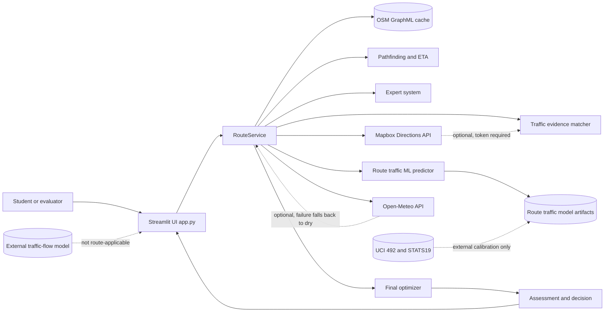
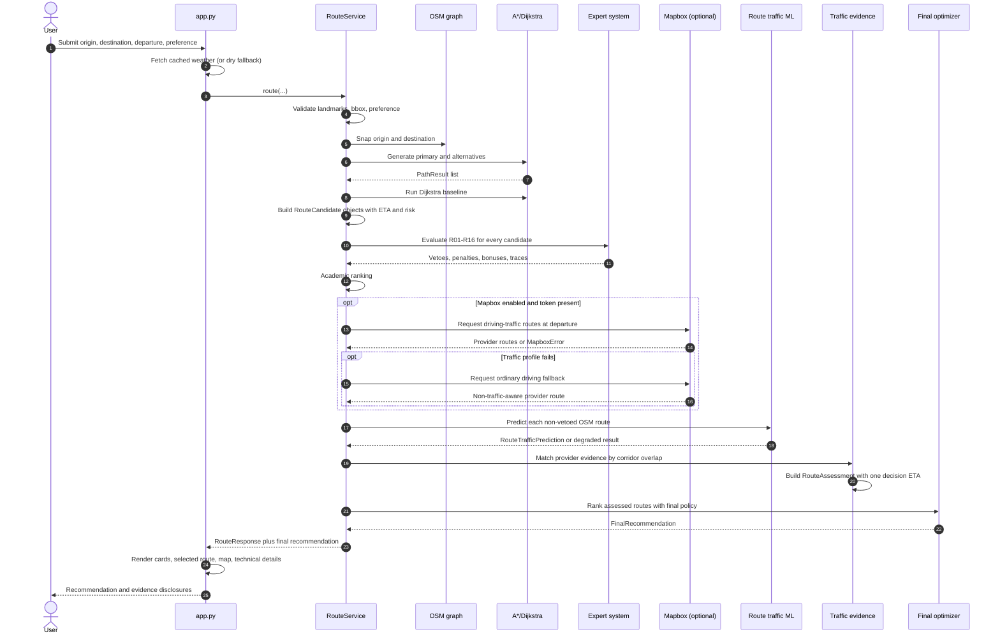

# System Architecture

## 1. Purpose and scope

Karachi Route Advisor is a single-process, local-first Streamlit application for comparing driving routes inside a pilot area of Gulistan-e-Jauhar, Karachi. It combines:

- a cached OpenStreetMap (OSM) drive graph,
- custom A* routing and a Dijkstra comparison baseline,
- analytical travel-time, road-risk, toll, and lighting estimates,
- a deterministic forward-chaining expert system,
- an optional route-specific traffic-band classifier trained on synthetic route scenarios,
- optional Mapbox Directions traffic evidence,
- optional Open-Meteo current weather,
- a final additive ranking layer.

The system is an advisory and academic decision-support prototype. It is not a navigation service, a validated real-world Karachi traffic forecaster, or a safety guarantee.

## 2. Architectural style

The codebase uses a layered, service-oriented architecture with immutable data contracts:

1. **Presentation layer** - Streamlit widgets and Folium maps in `app.py`.
2. **Orchestration layer** - `RouteService` coordinates the complete request in `src/service.py`.
3. **Routing and domain layer** - OSM graph preparation, A*, Dijkstra, alternatives, ETA, risk, and academic ranking.
4. **Intelligence and assessment layer** - expert rules, traffic evidence matching, ML inference, scenario assessment, and final ranking.
5. **Integration layer** - Mapbox, Open-Meteo, local observation helpers, and external model loaders.
6. **Artifact and data layer** - GraphML road graph, model bundles, JSON metadata, external datasets, and reports.

There is no database, message queue, authentication service, or separate backend. Streamlit owns the process, and `RouteService` is cached for the process lifetime with `@st.cache_resource`.

## 3. System context

Optional dependencies are shown with dotted arrows. The Mapbox token is read from the `MAPBOX_ACCESS_TOKEN` environment variable; no secret value is stored in source code or documentation.

## 4. Container and component view

```mermaid
flowchart TB
    subgraph Presentation
        APP[app.py]
        CACHE[Streamlit caches]
    end

    subgraph Orchestration
        SVC[src/service.py RouteService]
        CONTRACTS[src/contracts.py dataclasses]
    end

    subgraph Routing
        OSM[src/osm_graph.py]
        CORE[src/pathfinding/core.py]
        ASTAR[src/pathfinding/astar.py]
        DIJK[src/pathfinding/dijkstra.py]
        ALT[src/pathfinding/alternatives.py]
        ETA[src/eta.py]
        DEC[src/decision.py]
        ROUTING[src/routing.py facade]
    end

    subgraph Intelligence
        EXP[src/expert_system.py]
        EVID[src/traffic_evidence.py]
        PRED[src/route_traffic_ml.py]
        FEAT[src/route_traffic_features.py]
        CTX[src/route_features.py]
        FALLBACK[src/traffic_prediction.py]
        DEP[src/departure_forecast.py]
        FINAL[src/ai/optimizer.py]
        FINAL_FACADE[src/final_optimizer.py facade]
    end

    subgraph Integrations
        MB[src/mapbox_client.py]
        WX[src/weather.py]
        LOCAL[src/local_traffic.py]
        MLFLOW[src/ml_traffic.py]
    end

    subgraph Artifacts
        GML[(gulistan_jauhar_drive.graphml)]
        RT[(models/route_traffic)]
        DF[(models/departure_forecast)]
        TF[(models/traffic_flow)]
        EXT[(data/external)]
        SIM[(data/simulated)]
    end

    APP --> CACHE
    APP --> SVC
    APP --> LOCAL
    APP --> MLFLOW
    APP --> WX
    SVC --> CONTRACTS
    SVC --> OSM
    SVC --> ALT
    SVC --> ETA
    SVC --> DEC
    SVC --> EXP
    SVC --> EVID
    SVC --> PRED
    SVC --> FALLBACK
    SVC --> DEP
    SVC --> FINAL
    SVC --> MB
    SVC --> WX
    OSM --> GML
    ALT --> CORE
    ASTAR --> CORE
    DIJK --> CORE
    ROUTING --> ALT
    ROUTING --> ASTAR
    ROUTING --> DIJK
    EVID --> ETA
    EVID --> MB
    PRED --> RT
    PRED --> FEAT
    PRED --> CTX
    PRED --> DF
    DEP --> DF
    MLFLOW --> TF
    RT --> SIM
    RT --> EXT
    DF --> EXT
    FINAL_FACADE --> FINAL
```

## 5. Runtime request pipeline

## 6. Key architectural decisions

### 6.1 OSM routes are the only competing route options in the live assessment path

`RouteService.recommend_routes()` passes OSM academic routes and precomputed `RouteAssessment` objects to `build_final_recommendation()`. When assessments are supplied, `_build_assessment_recommendation()` ranks only those assessed OSM routes. Mapbox routes are used as matching evidence for an OSM corridor and are not appended as competing alternatives.

The optimizer still contains a legacy/general path that can mix Mapbox candidates when no assessments are supplied. That path is not the runtime path used by the Streamlit app. This distinction matters when reading `src/ai/optimizer.py` and the tests.

### 6.2 Evidence is applied once

The final decision ETA has one basis:

- matched Mapbox evidence applied to the OSM analytical ETA, or
- the free-flow ETA plus one ML-derived traffic premium, or
- the analytical OSM ETA when neither is usable.

The academic ETA, Mapbox absolute ETA, ML band, and road risk are not added repeatedly. See `src/traffic_evidence.py` and `src/ai/optimizer.py`.

### 6.3 Missing evidence is not zero evidence

- Incident risk is `UNAVAILABLE` for custom OSM routes unless matched provider annotations report an incident or closure.
- Unknown MAPbox road risk is handled conservatively rather than as zero in the legacy path.
- A map-matching attempt that fails is recorded as a non-applied evidence match; the app does not copy the provider ETA.
- An ML load failure or invalid departure produces an unavailable prediction, not a fabricated LOW band.

### 6.4 Synthetic ML labels are disclosed at every layer

The route-specific model is a real scikit-learn model trained on **synthetic** route-time labels. The synthetic labels are calibrated to real external time-of-week profiles from Minnesota and Great Britain, but no Karachi route-level traffic observations were used. This disclosure appears in model metadata, prediction explanations, reports, and the UI.

### 6.5 The external traffic-volume model is not used for route ranking

`src/ml_traffic.py` loads the UCI Minnesota benchmark model and explicitly marks it `route_applicable:false`. It is diagnostic/educational only. The live future-traffic classifier is the separate 34-feature route model in `src/route_traffic_ml.py`.

## 7. Data stores and external systems

| Store or system | Path / endpoint | Role | Failure behavior |
| --- | --- | --- | --- |
| OSM GraphML | `data/cache/gulistan_jauhar_drive.graphml` | Road network and edge attributes | Load error if missing and no OSM/Overpass access |
| Route model | `models/route_traffic/traffic_model.joblib` | 34-feature traffic-band classifier | Prediction unavailable |
| Accident prior | `models/departure_forecast/accident_model.joblib` | External STATS19 calendar prior | Accident evidence unavailable |
| External traffic benchmark | `models/traffic_flow/traffic_volume_model.joblib` | Non-route-applicable benchmark | Diagnostic unavailable |
| Mapbox Directions | `https://api.mapbox.com/directions/v5` | Optional provider ETA and annotations | Traffic profile failure triggers ordinary driving fallback; then OSM fallback |
| Open-Meteo | `https://api.open-meteo.com/v1/forecast` | Current weather | Dry assumption |
| Local observations | `data/local/traffic_observations.csv` | Opt-in future Karachi data | Summary reports not ready; no automatic training |
| UCI 492 | `data/external/metro_interstate/` | External calibration and benchmark | Training scripts fail if absent; runtime does not fetch |
| STATS19 | `data/external/stats19/` | External accident-time prior | Accident prior unavailable |

## 8. Deployment and runtime characteristics

- **Runtime:** Python virtual environment at `.venv`; Streamlit serves `app.py` (previously verified at `http://localhost:8501`).
- **Graph loading:** cached resource, loaded once per process; routing graph is a simplified `nx.DiGraph` retaining the fastest parallel edge.
- **Weather caching:** 10-minute Streamlit data cache.
- **Model loading:** joblib bundles loaded at service initialization; feature-schema mismatch disables predictions safely.
- **Persistence:** no request database. Results live in `st.session_state`; Mapbox results are transient and not cached or exported by the app.
- **Network:** only OSM/Overpass when the graph is absent or explicitly refreshed, Mapbox when enabled and token-present, and Open-Meteo when weather is fetched.
- **Security:** the Mapbox token is loaded from the environment, never printed; API errors are redacted before display.
- **Testing:** deterministic tests use fakes/mocks and a fixture graph; the full suite previously reported `193 passed in 117.22s`.

## 9. Trust boundaries

1. **User input boundary** - origin/destination must be approved landmarks; origin and destination must differ; departure is a local naive datetime; preference must be one of four known values.
2. **Route graph boundary** - only whitelisted drive highway types survive graph preparation; the largest strongly connected component is retained.
3. **External provider boundary** - Mapbox evidence must pass traffic-profile, corridor-overlap, baseline, delay, and segment-coverage checks before it affects an OSM ETA.
4. **Model boundary** - model artifact feature names must exactly match the code schema; predictions require a future departure and OSM edge features.
5. **Synthetic-data boundary** - synthetic route labels never become “observed Karachi traffic” in UI or documentation.
6. **Secret boundary** - only the environment variable name and presence boolean is exposed.

## 10. Architectural limitations

- The network is limited to a small pilot bbox and nine landmarks.
- OSM turn restrictions, lane-level capacity, signal timing, and live city incident feeds are not fully modeled.
- The graph's analytical speed and risk values are heuristics, not calibrated Karachi measurements.
- Mapbox and Open-Meteo depend on network availability and external terms.
- The route-traffic classifier has no Karachi ground-truth validation.
- The app is single-user, local, and not hardened for public deployment.
